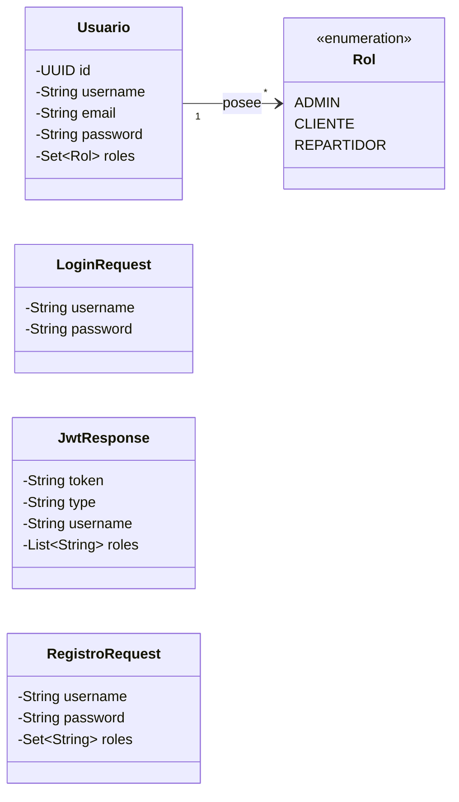

# Security Service 🔒🛡️

## 📄 Descripción del Proyecto

**Security Service** es un microservicio backend encargado de la gestión de usuarios, la autenticación basada en JSON Web Tokens (JWT), el cifrado de credenciales con BCrypt, el control de acceso basado en roles y el filtrado de peticiones seguras. Este repositorio contiene el desarrollo del módulo de seguridad del sistema **Logitrack**, diseñado con una arquitectura desacoplada por capas y documentado con Javadocs.

---

## 📊 Modelo de Dominio: Seguridad y Autenticación

Este diagrama describe las entidades principales del dominio de seguridad y su relación con los mecanismos de autenticación y autorización.



---

## 📝 Descripción del Dominio de Seguridad

El microservicio centraliza el control de identidad y la protección de los recursos de la plataforma Logitrack.

### 1. Entidades Principales

- **Usuario**: representa a quien interactúa con el sistema y posee credenciales de acceso. Se persiste en la tabla `usuarios`.
    - Atributos: identificador único (`id`, UUID), nombre de usuario único (`username`), correo electrónico único (`email`), contraseña cifrada con BCrypt (`password`) y conjunto de roles asignados (`roles`, almacenados en la tabla `usuario_roles`).

### 2. Enumeraciones

- **Rol**: define los niveles de autorización dentro de la plataforma.
    - `ADMIN`: privilegios administrativos sobre el sistema.
    - `CLIENTE`: clientes finales que consumen la plataforma.
    - `REPARTIDOR`: operadores encargados de la logística.

### 3. DTOs de Transferencia

- **LoginRequest**: entrada con las credenciales de inicio de sesión.
- **RegistroRequest**: entrada para el alta de nuevos usuarios.
- **JwtResponse**: respuesta con el token JWT emitido, el tipo de token (`Bearer`), el nombre de usuario y sus roles.

---

## 🚀 Funcionalidades e Infraestructura Implementadas

- 🔐 **Autenticación stateless con JWT (`JwtUtil`)**: emisión, firma y validación de tokens con JJWT (v0.12.6). Los tokens incluyen `sub` (username), `userId`, `roles` e `iss` (emisor) y vencen por defecto a la hora (`JWT_EXPIRATION_MS`).
- 🛡️ **Filtro de seguridad HTTP (`JwtAuthenticationFilter`)**: intercepta cada petición entrante, extrae el token Bearer, lo valida y configura el contexto de autenticación en Spring Security.
- ⚙️ **Configuración de seguridad (`SecurityConfig`)**: define el `SecurityFilterChain` (sesiones stateless, CSRF deshabilitado, solo login, registro y Swagger públicos; el resto requiere token), respuestas 401/403 en JSON, el `AuthenticationManager` y el bean `BCryptPasswordEncoder`.
- 🧩 **Capa de servicio (`AuthService`, `UsuarioService`)**: concentra la lógica de login, registro y consultas; los controladores solo traducen HTTP.
- 🚦 **Regla de alta de roles**: el registro público solo crea usuarios `CLIENTE`. Los roles `ADMIN` y `REPARTIDOR` solo los puede asignar un usuario `ADMIN` (enviando su token en `/api/auth/register`).
- 🕓 **Auditoría (`EntidadAuditable`)**: `Usuario` registra automáticamente `fecha_creacion` y `fecha_ultima_modificacion`.
- 📘 **Documentación OpenAPI / Swagger** en `/swagger-ui.html`, con botón *Authorize* para probar con el token.
- 🧯 **Manejo global de errores (`GlobalExceptionHandler`)**: respuestas JSON uniformes (400, 401, 403, 404, 405, 409, 500).
- 🔑 **Cifrado de credenciales (BCrypt)**: las contraseñas se cifran en el registro y se validan en el inicio de sesión.
- 🗄️ **Capa de persistencia (`UsuarioRepository`)**: acceso a datos con Spring Data JPA, incluyendo `findByUsername` y las validaciones de existencia (`existsByUsername`, `existsByEmail`).
- 👤 **Carga de detalles de usuario (`UserDetailsServiceImpl`)**: recupera el usuario desde la base de datos y lo adapta al modelo `UserDetails` de Spring Security.
- 🌐 **Controladores REST (`AuthController`, `UserController`)**: login, registro, usuario autenticado y listado de usuarios (solo ADMIN).

---

## 🛠️ Tecnologías Utilizadas

| Categoría | Tecnología |
|---|---|
| Lenguaje | Java 25 |
| Framework | Spring Boot 4.1.2 |
| Seguridad | Spring Security |
| Tokens | JJWT (JSON Web Token) 0.12.6 |
| Persistencia | Spring Data JPA / Hibernate / MySQL |
| Configuración | Spring Cloud Config (cliente, opcional) |
| Utilidades | Lombok |
| Gestor de dependencias | Apache Maven (Maven Wrapper) |
| Control de versiones | Git (flujo modular basado en ramas `feature/*`) |

---

## 📁 Estructura Física del Proyecto

```text
security-service/
├── src/
│   └── main/
│       ├── java/ar/edu/unju/fi/arquitecturas/logitrack/securityservice/
│       │   ├── SecurityServiceApplication.java
│       │   ├── config/
│       │   │   ├── AdminBootstrap.java
│       │   │   ├── JpaAuditingConfig.java
│       │   │   ├── OpenApiConfig.java
│       │   │   └── SecurityConfig.java
│       │   ├── controller/
│       │   │   ├── AuthController.java
│       │   │   └── UserController.java
│       │   ├── dto/
│       │   │   ├── JwtResponse.java
│       │   │   ├── ApiError.java
│       │   │   ├── LoginRequest.java
│       │   │   ├── RegistroRequest.java
│       │   │   └── UserResponse.java
│       │   ├── exception/
│       │   │   └── GlobalExceptionHandler.java
│       │   ├── filter/
│       │   │   └── JwtAuthenticationFilter.java
│       │   ├── model/
│       │   │   ├── EntidadAuditable.java
│       │   │   ├── Rol.java
│       │   │   └── Usuario.java
│       │   ├── repository/
│       │   │   └── UsuarioRepository.java
│       │   ├── service/
│       │   │   ├── AuthService.java
│       │   │   ├── UsuarioService.java
│       │   │   └── impl/
│       │   │       ├── AuthServiceImpl.java
│       │   │       ├── UserDetailsServiceImpl.java
│       │   │       └── UsuarioServiceImpl.java
│       │   └── util/
│       │       └── JwtUtil.java
│       └── resources/
│           └── application.yaml
├── pom.xml
└── README.md
```

| Directorio | Contenido |
|---|---|
| `config/` | Configuración central de Spring Security (`SecurityConfig`) |
| `controller/` | Controlador REST de login y registro (`AuthController`) |
| `dto/` | Objetos de transferencia (`LoginRequest`, `RegistroRequest`, `JwtResponse`) |
| `filter/` | Filtro de interceptación de peticiones JWT (`JwtAuthenticationFilter`) |
| `model/` | Entidad JPA (`Usuario`) y enum de roles (`Rol`) |
| `repository/` | Interfaz de acceso a datos (`UsuarioRepository`) |
| `service/` | Lógica de negocio de autenticación y usuarios (`AuthService`, `UsuarioService` y sus implementaciones, `UserDetailsServiceImpl`) |
| `exception/` | Manejo global de errores (`GlobalExceptionHandler`) |
| `util/` | Generación y validación de tokens (`JwtUtil`) |
| `resources/` | Configuración del servicio (`application.yaml`) |

---

## 🌿 Estructura de Ramas

Ramas principales:

| Rama | Propósito |
|---|---|
| `main` | Rama estable del proyecto. |
| `develop` | Rama de integración donde se unen las ramas `feature/*`. |

Ramas de desarrollo del módulo:

| Rama | Propósito / Descripción |
|---|---|
| `feature/sec-model` | Creación de la entidad `Usuario` y el enum `Rol`. |
| `feature/sec-repository` | Interfaz de persistencia `UsuarioRepository` con `findByUsername` y `existsByUsername`. |
| `feature/sec-database` | Configuración inicial de `application.yaml` y conexión a la base de datos `security_service`. |
| `feature/sec-config` | Integración de modelos, repositorio y conexión, y configuración del bean de BCrypt en `SecurityConfig`. |
| `feature/sec-jwt` | Implementación de `JwtUtil`, `JwtAuthenticationFilter`, `UserDetailsServiceImpl` y `SecurityFilterChain`. |
| `feature/sec-controller` | DTOs de autenticación y `AuthController` con el endpoint de login. |
| `feature/sec-register` | `RegistroRequest` y endpoint de registro en `AuthController`. |
| `feature/sec-docs` | Documentación técnica y archivo `README.md`. |

---

## ⚙️ Instalación y Ejecución Local

### Prerrequisitos

- Java Development Kit (JDK) 25.
- Apache Maven instalado (o uso de `./mvnw`).
- MySQL en ejecución, con una base de datos llamada `security_service`.

### Pasos

1. Clonar el repositorio y situarse en la rama que contiene la implementación completa del servicio:

   ```bash
   git clone https://github.com/Logitrack-Penguin/security-service.git
   cd security-service
   git checkout develop
   ```

2. Definir las variables de entorno (ver `.env.example`). Como mínimo `DB_PASSWORD` y `JWT_SECRET`, que no tienen valor por defecto a propósito.

3. Compilar el proyecto:

   ```bash
   ./mvnw clean compile
   ```

4. Ejecutar la aplicación:

   ```bash
   ./mvnw spring-boot:run
   ```

El microservicio inicia por defecto en el puerto **8081**. Las tablas `usuarios` y `usuario_roles` se crean automáticamente (`ddl-auto: update`). La conexión al Config Server (`http://localhost:8085/`) es opcional: si no está activo, se usan las propiedades locales.

---

## 🔌 Endpoints Principales de la API

| Método | Endpoint | Descripción |
|---|---|---|
| `POST` | `/api/auth/login` | Autentica las credenciales de un usuario existente y devuelve un token JWT junto con sus roles. |
| `POST` | `/api/auth/register` | Registra un usuario (BCrypt, username y email únicos). Público para `CLIENTE`; `ADMIN`/`REPARTIDOR` requieren token de ADMIN. |
| `GET` | `/api/auth/me` | Devuelve los datos del usuario dueño del token. |
| `GET` | `/api/users` | Lista los usuarios registrados (solo `ADMIN`). |

Ejemplo de respuesta de `/api/auth/login`:

```json
{
  "token": "eyJhbGciOiJIUzI1NiJ9...",
  "type": "Bearer",
  "userId": "3f1c6c1e-...",
  "username": "usuario",
  "roles": ["ADMIN"]
}
```

---

## 🔗 Contrato del token para shipment-service y courier-service

Los demás microservicios validan el token **localmente**, sin llamar a security-service:

- Algoritmo `HS256` con la misma clave `JWT_SECRET` (Base64, mínimo 32 bytes).
- Exigir el emisor `iss = logitrack-security-service` (`JWT_ISSUER`).
- `sub`: username · `userId`: UUID del usuario (usar para validar la pertenencia de los recursos) · `roles`: lista sin prefijo (`ADMIN`, `CLIENTE`, `REPARTIDOR`), que cada servicio mapea a `ROLE_<rol>`.

---

## 🧪 Pruebas

```bash
./mvnw test
```

Usan el perfil `test` (H2 en memoria, sin MySQL ni Config Server): `JwtUtilTest`, `AuthServiceImplTest` (Mockito) y `AuthControllerIntegrationTest` (MockMvc).

---

## 📋 Estado del Módulo

- [x] Modelo de dominio: entidad `Usuario` y enum `Rol`.
- [x] Capa de persistencia (`UsuarioRepository`).
- [x] Conexión a base de datos MySQL (`application.yaml`).
- [x] Configuración base de Spring Security, BCrypt y JJWT.
- [x] Utilidad de tokens (`JwtUtil`) y filtro de peticiones HTTP (`JwtAuthenticationFilter`).
- [x] Endpoints de autenticación y registro (`AuthController`).
- [x] Capa de servicio, auditoría, Swagger y manejo global de errores.
- [x] Pruebas unitarias y de integración sin dependencias externas.
- [x] Documentación técnica en `README.md`.
